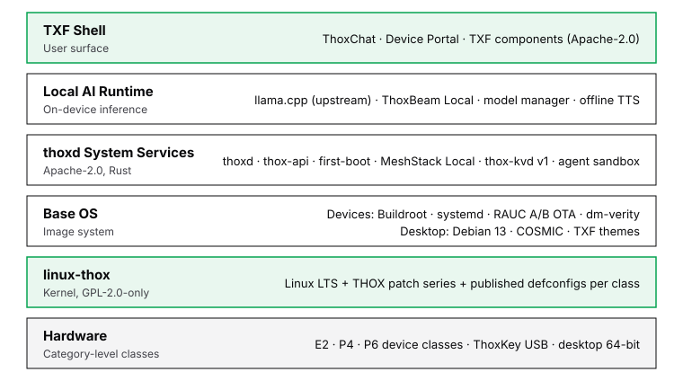
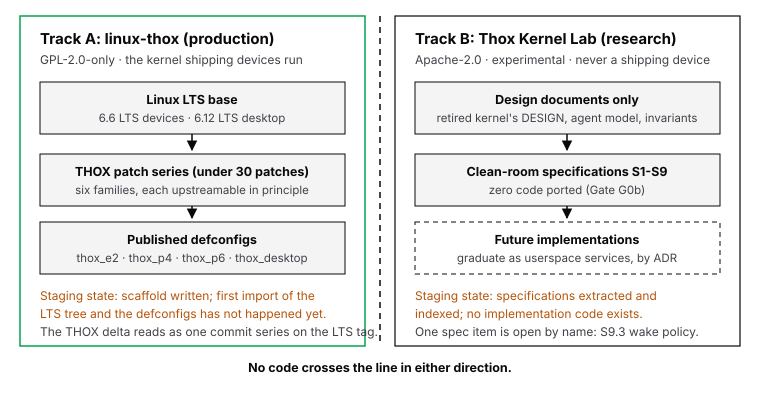
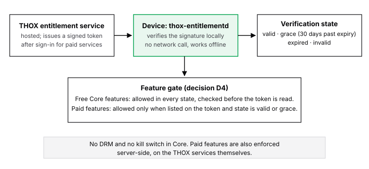
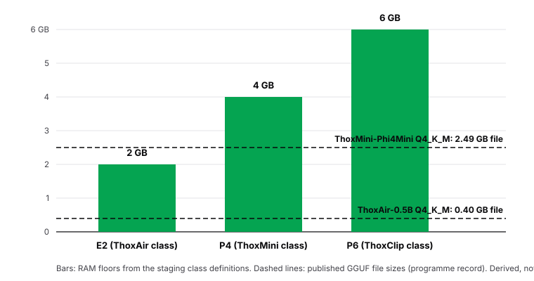
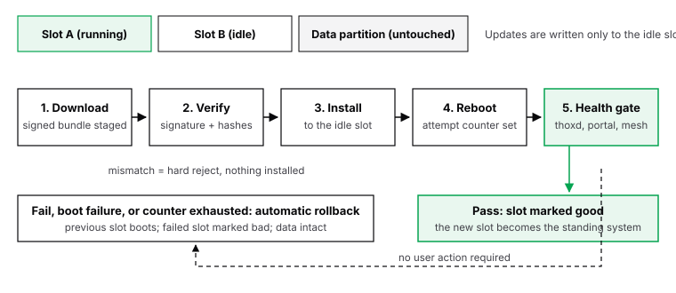
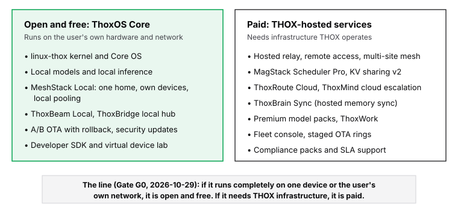

# ThoxOS: An Open Kernel and Operating System for Local-First AI

**Technical Whitepaper — Design Paper**

**THOX.ai**

Your AI. Your Data. Your Rules.™

**Date:** October 31, 2026

**Version:** 0.1.0

**Authors:** Sadie Weaving, Chief Agentic Officer, THOX.ai

**Accountable human author:** Tommy Xaypanya, CTO & Co-Founder, THOX.ai

**Authorship disclosure:** The primary author is a synthetic digital
human, disclosed as such wherever this paper is distributed. The
accountable human author directed the programme and holds its release
gates. No human peer review is claimed for this version.

**Document status:** This paper reports only what is verified in the
sources named in its provenance register. Training completion, artifact
publication, model quality and hardware qualification are treated as
four separate claims throughout, and evidence for one is never used as
evidence for another.

> **Status as of October 31, 2026 (reconciled against the verified
> release bundle).** ThoxOS Core exists as tested staging code: an
> entitlement reference implementation with a passing 25-test suite,
> per-class image definitions that pass a 27-check validator, and
> RAUC A/B update templates. That code is packaged in the ThoxOS
> v0.1.0 release bundle — four source tarballs (`thoxos-core`,
> `linux-thox`, `thox-kernel-lab-specs`, `thoxos-images`, all
> version 0.1.0), assembled and SHA-256-verified on October 31, 2026;
> names, sizes, and checksums are recorded in the companion
> PENDING-VERIFY register (item P1, resolved). The linux-thox kernel
> package ships pins (Linux 6.6.161 for devices, 6.12.115 for
> desktop), a build script, an explicitly empty patch series, and
> per-class config fragments labelled as intent; the first import of
> the Linux LTS tree and the defconfigs have not happened. Thox
> Kernel Lab holds clean-room design specifications (S1–S9) and no
> implementation code. A Desktop Edition release candidate (Debian
> 13 + COSMIC, `1.0.0-rc.1+20261025`) was built previously and gated
> in a VM; it is an internal artefact with four open defects —
> v0.1.0 ships its build definitions and hashes, not the image. The
> ThoxOS kernel model family (27B, 4B, 0.8B) has provisioned
> repositories with complete cards and no weights. Nothing in this
> programme is publicly downloadable yet: publication is directed
> under the CTO's decision D10 of October 31, 2026, and the
> publication step itself is the release's last step. No ThoxOS
> device image has been built or booted, and no device is qualified.

## Abstract

ThoxOS is the operating system for THOX's local-first AI devices and
desktops: an open-source system in which the kernel, the device OS, and
the local mesh are free and auditable, and the paid layer is confined to
services that require infrastructure THOX operates. This paper specifies
the system as designed and as staged today. It makes four contributions.
(1) A kernel position: production devices run linux-thox, a Linux LTS
fork under GPL-2.0-only carrying a small, upstreamable THOX patch series
and per-class configuration published as fragments (the defconfigs
land with the first import), while the from-scratch Rust
kernel work continues as Thox Kernel Lab, a clean-room research track
that is specified to the level of 26 numbered requirements and holds no
implementation code. (2) An entitlement design that replaces DRM with a
signed offline token, local verification, a 30-day grace window, and
server-side enforcement on hosted services only; free Core features are
never gated, in any token state, and the reference implementation that
pins this contract passes its full 25-test suite. (3) A device-class
model (E2, P4, P6) with category-level floors, Buildroot image
definitions guarded by a 27-check validator, and RAUC A/B updates whose
health gate rolls back automatically on any failed check. (4) An
honest staging account: what is tested, what is specified, what is
scaffolded, and what does not exist yet, including the regimes where
this design loses, stated in the open. The evaluation section is an
evaluation design plus the staging test evidence that exists; it
contains no benchmarks, because none have been run.

## Contents

1. Introduction
2. Background and related work
3. Design principles and terminology
4. The ThoxOS Core architecture
5. The kernel: linux-thox and Thox Kernel Lab
6. Entitlement without DRM
7. Device classes and capacity
8. Updates, integrity, and rollback
9. MeshStack and the ThoxOS kernel models
10. Evaluation design and staging evidence
11. Limitations
12. Conclusion

Provenance register. Document control. References.

# 1. Introduction

THOX builds small computers whose reason to exist is that they run AI
locally: ThoxAir, ThoxMini, and ThoxClip devices, the ThoxKey USB
companion, and desktop systems. The company's promise is "Your AI. Your
Data. Your Rules.™" A promise of that shape cannot rest on marketing.
If the operating system on the device is closed, the user is asked to
trust that it does not phone home, does not gate local features behind
a subscription state, and does not degrade when a payment lapses. An
open operating system converts each of those trust requests into
something the user can read.

This paper specifies that operating system, and it does so under a
discipline the rest of the THOX paper programme uses: every claim is
one of four kinds — a training claim, a publication claim, a quality
claim, or a hardware claim — and the evidence for each is named where
the claim is made. ThoxOS is, at writing time, a design with tested
staging components. The paper therefore reads differently from a
results paper. Where a component is specified but not built, the text
says "specified." Where a repository is a scaffold, the text says
"scaffold." Where nothing exists, the text says so, and the roadmap
section of the conclusion states what has to happen, in what order,
before the missing piece can be claimed.

Three decisions shape everything that follows, and each was taken
deliberately against an alternative.

First, the production kernel is Linux. THOX has a from-scratch Rust
microkernel in its history: 32 crates, agents as first-class kernel
objects, inference as a scheduled syscall, verified in QEMU to the
level of signed internal releases. It was retired in August 2026
without ever running a shipping device. Section 5 explains why the
production line is a Linux LTS fork, why the Rust work continues as a
research laboratory rather than being quietly resurrected, and why the
laboratory is clean-room: zero code is ported from the retired kernel,
by a founder gate decision, and its specifications were extracted from
design documents only.

Second, the money is in services, not in the OS. The open/paid line is
a single sentence, approved at Gate G0 on October 29, 2026: if it runs
completely on one device, or on the user's own home network, with no
THOX cloud, it is open and free; if it needs THOX-operated
infrastructure, multi-site coordination, fleet scale, hosted models,
or a support SLA, it is paid. Section 9 gives the service-by-service
split and the guardrails that keep the free core from hollowing out.

Third, entitlement is not DRM. Paid features unlock with a signed
token that the device verifies locally, offline, with a 30-day grace
window after expiry. Free features are never gated — not by an expired
token, not by an invalid token, not by the absence of a token. The
enforcement that matters lives on THOX's own servers, where paid
services check entitlement themselves. Section 6 specifies the
contract, gives the verification algorithm, and works the grace
arithmetic on the reference implementation's own test timeline.

The intended reader is an engineer or a technically literate user
deciding whether to build on, contribute to, or simply trust ThoxOS.
The companion documents to this paper are the kernel information file
(KERNEL.md), the install guides for bare metal, Intel Mac dual boot,
Apple silicon, and the device classes, and the run book (RUN.md), all
in the same documentation set and all carrying the same status
discipline.

# 2. Background and related work

## 2.1 The device and desktop estate ThoxOS replaces

ThoxOS did not start from a blank page. The shipping device images
today are Linux-based: per-device image lines for the Mini, Air, and
Pi Zero-class targets, carrying thoxd-family services, a first-boot
flow, a device portal, and a local OpenAI-compatible inference endpoint
via llama.cpp. The desktop side had three overlapping lines (an Ubuntu
remix, an Arch remix with an early linux-thox kernel, and the newer
Debian + COSMIC line). The open-source programme consolidates that
estate: one Core tree for devices, one Desktop Edition (Debian 13 +
COSMIC, decided in the programme's DECIDE-01 record), one kernel. The
consolidation is recorded because it is the kind of sprawl that kills
open-source launches: a community that meets three "official" desktops
in the first week does not come back.

## 2.2 Open-core operating systems: what the record shows

Five precedents carry the design, and the paper programme's research
record examined each before the plan was written.

**Red Hat / Fedora → RHEL.** The community distribution is free; the
enterprise product sells assurance: certified hardware, security
patches under SLA, compliance artefacts, support. The lesson THOX
adopts is that enterprises pay for assurance, not for code, and that
the free system must be genuinely complete for the paid layer to be
legitimate.

**Canonical / Ubuntu Pro.** The base OS is free forever; Pro is
additive (extended security maintenance, compliance, support). The
specific rule THOX adopts: security updates for supported Core
releases are never paywalled. A subscription that lapses degrades
hosted services; it never degrades the security posture of a device
the user owns.

**Google / AOSP → Google Mobile Services.** AOSP is Apache-2.0 with a
GPLv2 kernel; a manufacturer can build a working device from it alone;
the proprietary services sit outside under separate agreement. This is
the closest structural parallel to ThoxOS: Core is the AOSP position,
and MeshStack Pro, ThoxRoute Cloud, and ThoxWork occupy the services
position. The known failure mode of that pattern — innovation
migrating into the closed layer until the open core hollows out — is
addressed by explicit guardrails in Section 9.

**SUSE / openSUSE and GitLab-style open core.** A published split,
maintained in public, is what makes an open-core line defensible.
ThoxOS adopts the mechanism directly: a stewardship page that lists,
per service, what is free, what is paid, and why, published before
launch rather than after the first controversy.

**From-scratch Rust kernels: Redox and Asterinas.** Redox is a real
Rust microkernel with user-space drivers and capability security; after
years its ecosystem remains small and hardware support spotty.
Asterinas takes a framekernel approach and deliberately reuses the
Linux syscall interface to avoid the porting tax. THOX's own retired
kernel is the local data point with the same shape: strong QEMU
evidence, zero shipping devices. The lesson is not that novel kernels
are worthless; it is that a novel kernel buys safety properties and
research standing at the price of drivers, applications, and years.
Section 5 prices that trade explicitly and chooses Linux for
production and a laboratory for the research.

## 2.3 Build systems and update systems

For fixed-function device images the programme evaluated Buildroot,
Yocto/OpenEmbedded, and immutable NixOS-style builds. Buildroot is the
v1 choice: one fixed-function image, whole-image updates, no on-device
package manager by design, and a shallow learning curve. Yocto offers
layered recipes, SDK generation, and built-in SBOM and CVE machinery
at a steep tooling cost; it is a Phase 3 evaluation spike, not the v1
base. The desktop is a distribution choice rather than a build-system
choice: Debian 13 with the COSMIC desktop and TXF themes.

For updates, the design requires A/B atomicity from the first release,
because partition layout is nearly impossible to retrofit. RAUC is the
device update system: signed bundles, two rootfs slots, a persistent
data partition, and bootloader-managed fallback. Section 8 specifies
the flow and the health gate that decides whether a new slot stands or
rolls back.

Table 1 compares ThoxOS Core against the reference points on the
dimensions this paper's design turns on.

**Table 1 — System comparison on design dimensions.**

| Dimension | ThoxOS Core | AOSP | Stock Debian | Redox |
| --- | --- | --- | --- | --- |
| Kernel | Linux LTS fork (GPL-2.0-only) | Linux (GPLv2) | Linux (GPLv2) | Own Rust microkernel (MIT) |
| Userspace license | Apache-2.0 (THOX code) | Apache-2.0 | DFSG-free mix | MIT |
| Entitlement model | Signed offline token; free features never gated; no DRM | None in the open tree; services gated by separate agreement | None | None |
| Update model | RAUC A/B, signed, health-gated rollback | A/B (device-dependent) | Package-based (APT) | Package/image, project-defined |
| Paid layer | Hosted services only, server-side enforcement | Proprietary services outside the tree | None (support sold separately) | None |
| Local AI runtime | First-class (llama.cpp, local mesh) | Not a system concern | Not a system concern | Not a system concern |
| Hardware posture | Defined compute classes E2/P4/P6 + desktop | Broad, vendor-driven | Broad | Narrow, project-driven |

The comparison is a design comparison, not a benchmark: no performance
claim is made or implied by any row.

# 3. Design principles and terminology

## 3.1 Principles

Six principles govern the design. Each is stated with the mechanism
that enforces it, because a principle without a mechanism is a slogan.

1. **Local-first, always.** Core works fully offline: no THOX account,
   no phone-home, no telemetry by default. Opt-in telemetry, where it
   exists, is documented per surface. The monthly "airplane test" — a
   fresh device, no account, no network beyond the LAN, completing
   first-boot, local chat, local mesh with a second device, and an OTA
   rollback — is the standing regression check. If it fails, that is a
   P0 defect, not a sales opportunity.
2. **No crippled free tier.** Core is a complete, usable, secure OS.
   Paid services add scale, hosting, convenience, and assurance, never
   basic functionality or security.
3. **No kill switch for Core.** A lapsed subscription degrades paid
   services only. Devices, local models, the local mesh, and user data
   keep working. Section 6 shows the mechanism: free features are
   allowed before the token is ever examined.
4. **Open development, not open dumps.** Public repository, public
   roadmap, public issue tracker, DCO sign-off for contributions.
   Periodic source drops over private development are a known trust
   failure in platform projects; the programme does not repeat it.
5. **TXF governs user-facing surfaces.** The THOX Experience Fabric is
   the canonical design and development framework for Core surfaces;
   on Apple platforms, Apple conventions govern platform behaviour per
   the standing pre-flight rule.
6. **Patent-pending work stays protected.** MagStack device-to-device
   resource sharing is described at interface level in open code; the
   scheduling implementation that is the inventive core ships as the
   paid MeshStack service until the filings mature and the founders
   decide otherwise.

## 3.2 Terminology

The paper uses these terms with these meanings, and the companion
documents use them identically.

- **ThoxOS Core.** The free, open-source operating system: linux-thox,
  the thoxd service set, the portal and shell, the local AI runtime,
  MeshStack Local, and the OTA machinery. Never "Lite" or "Community
  Edition": Core is the complete system everything else builds on.
- **linux-thox.** The production kernel: a Linux LTS fork, GPL-2.0-only,
  carrying the THOX patch series and per-class configuration —
  published as config fragments in v0.1.0; the defconfig files land
  with the first import.
- **Thox Kernel Lab.** The research track: a clean-room re-derivation of
  the retired from-scratch kernel's design, as specifications today.
  Always labelled experimental. Never the kernel a shipping device runs.
- **Compute class.** A category-level hardware floor (E2, P4, P6)
  defined by CPU class, memory floor, storage floor, and on-device
  model class. Public documents name classes, never board or SoC
  part numbers.
- **Entitlement.** The signed token that records which paid features an
  account holds. A token grants; it never revokes local capability.
- **Feature.** A named capability id in the entitlement catalogue
  (Section 6.3), classified free or paid exactly once, in one place.
- **Grace.** The 30-day window after a token's expiry during which its
  paid features remain allowed on the device.
- **MeshStack Local.** Mesh behaviour among a user's own devices on
  their own network: discovery, WireGuard mesh, pooled local
  inference. Part of Core.
- **Device qualification.** The gate at which a specific build is
  verified on physical hardware of its class. QEMU results qualify
  software behaviour only, never hardware. No artifact in this paper
  is device-qualified.

## 3.3 Licensing and marks

The license split follows the architecture. linux-thox is
GPL-2.0-only, as a Linux derivative must be, with full source and the
source offer accompanying every binary image. THOX's own userspace is
Apache-2.0 — the fleet standard — chosen for its patent grant and
commercial clarity. Documentation, including this paper, is CC BY
4.0. There is no source-available or Business Source License anywhere
in Core: licences that merely resemble open source would undercut the
claim the whole programme rests on. Contributions use the Developer
Certificate of Origin (`Signed-off-by`), the Linux-ecosystem norm,
with AI-generated contributions disclosed in the pull-request
template. Trademark is separate from copyright and is retained: the
code may be forked, but a fork may not call itself ThoxOS, use the
THOX marks, or imply certification. "Built on ThoxOS Core" as a
factual statement is allowed. One known exposure is managed by
isolation: pre-existing GPL-3.0 code elsewhere in the estate stays
out of Core and out of the paid add-ons' linking boundary.

# 4. The ThoxOS Core architecture

Figure 1 shows the Core stack. The architecture is deliberately
conventional below the AI runtime and deliberately opinionated above
it: the parts that must be boring (kernel, base system, updates) are
upstream technology with a thin THOX delta, and the parts that carry
the product (local inference, the mesh, the agent sandbox) are THOX
code under Apache-2.0.



*Figure 1 — The ThoxOS Core stack. Schematic.*

The **kernel layer** is linux-thox (Section 5). The **base OS** is
Buildroot with systemd for device classes — one fixed-function image
per class, a read-only rootfs under dm-verity, and a separate encrypted
data partition — and Debian 13 + COSMIC for the Desktop Edition, which
lives in its own repository line by the programme's consolidation
decision. The **service layer** is Rust: `thoxd` (system glue and
status), `thox-api` (local REST), first-boot, the device portal,
MeshStack Local (mDNS discovery plus a WireGuard mesh among the user's
own devices), `thox-kvd` v1 (the KV tier store in its manifest-lookup
and route-to-cache form; KV transfer between devices is a v2, paid
service feature by earlier ruling, and is not in Core), and the agent
sandbox (namespaces plus Landlock, default-deny capability grants,
per-agent budgets). The **runtime layer** runs local inference through
llama.cpp, brokers it through ThoxBeam Local under a local policy, and
manages open models, including the published THOX device models. The
**shell layer** is TXF-governed: ThoxChat and the device portal are the
surfaces a user touches.

Two boundaries in this stack are load-bearing for the licensing and
business design. The first is the GPL boundary: THOX userspace is
Apache-2.0 and talks to the GPL-2.0 kernel across the standard syscall
boundary, and paid add-ons are separate processes and services
communicating over documented APIs, never linked into GPL code. The
second is the open/paid boundary of Figure 5 (Section 9): everything in
Figure 1 is Core, and everything paid arrives as a service the device
talks to, not as code the device is missing.

What is actually in the staging tree today, stated plainly: the
entitlement reference implementation (Section 6), the per-class image
definitions (Section 7), the RAUC templates (Section 8), and
repository scaffolding to the THOX Repository Creation Standard. The
service layer above is the design the staging tree is growing into;
its components exist across the wider THOX estate (the shipping device
images run thoxd-family services today) and are being consolidated
into the Core tree — they are not yet a buildable Core image, and this
paper does not claim one. Separately from the staging tree, a Desktop
Edition release candidate (Debian 13 + COSMIC, `1.0.0-rc.1+20261025`)
was built on a fleet host and gated in a VM harness; it is an internal
evaluation artefact with four open defects (Section 11, item 8), its
kernel is Debian's 6.12.113 rather than linux-thox, and the v0.1.0
bundle ships its build definitions and hashes — not the image.

# 5. The kernel: linux-thox and Thox Kernel Lab

## 5.1 Track A: linux-thox, the production kernel

linux-thox is a THOX kernel package built from the current Linux LTS,
not a new kernel. The base is Linux 6.6 LTS for device images (long
support window) and 6.12 LTS for the desktop class. The THOX delta is a
patch series, targeted at fewer than 30 patches, each upstreamable in
principle, published as a readable commit series on top of the LTS tag:
`git log` between the LTS tag and HEAD is the whole THOX story, by
design. The patch families, from the staging tree's PATCHES.md, are:

1. Board-support and device enablement per production compute class,
   at category level.
2. MagStack connector detection with power and clustering uevents —
   interface only; the scheduling logic lives in a userspace service,
   not in the kernel.
3. Accelerator plumbing through upstream DRM/accel and dma-buf. No
   out-of-tree binary blobs live in the open repository; a vendor blob
   a board requires is a separate, clearly labelled download under its
   own license.
4. Hardening: the KSPP recommended settings, module signing, lockdown,
   and dm-verity support.
5. Low-memory tuning for the E2 class (zram, MGLRU) and scheduler and
   cpufreq defaults tuned for bursty inference.
6. Memory-tier pressure signals for `thox-kvd` v1. KV transfer does
   not go in the kernel.

The configs are product. Table 2 specifies the four defconfigs; a
defconfig is the portable statement of what a THOX kernel is, across
any equivalent-or-better production components that meet the class
floors. In v0.1.0 the four are published as per-class config
*fragments* expressing the same intent (the linux-thox package's
`configs/` directory); the defconfig files themselves are generated
from those fragments at the first import and do not exist yet.

**Table 2 — Defconfigs (specification; published in v0.1.0 as config fragments).**

| Defconfig | Base | Class | Defining content |
| --- | --- | --- | --- |
| `thox_e2_defconfig` | 6.6 LTS | E2 entry | Low-memory tuning (zram, MGLRU), hardening set, dm-verity, no desktop stack |
| `thox_p4_defconfig` | 6.6 LTS | P4 performance | E2 set plus accelerator plumbing and inference-burst scheduler defaults |
| `thox_p6_defconfig` | 6.6 LTS | P6 performance-plus | P4 set plus capture-pipeline headroom configuration |
| `thox_desktop_defconfig` | 6.12 LTS | Desktop 64-bit | Desktop driver breadth, COSMIC session support, development tooling hooks |

Rebase cadence follows LTS point releases monthly, with a major LTS
move yearly behind a QEMU and hardware gate. The verification bar for
a kernel release is: CI builds for arm64 and x86_64, a QEMU boot, one
physical device per compute class, and the OTA rollback test of
Section 8.

The first import, when it runs, is a defined procedure rather than an
event: take the LTS tag as the base; extract the Insider line's THOX
delta and re-express it as the patch series of Section 5.1, dropping
anything that upstream has since absorbed; land the four defconfigs
of Table 2; bring CI to green on arm64 and x86_64; and boot the
result under QEMU before any hardware is touched. Each step leaves
the repository in a state a reviewer can diff, which is the point of
building the kernel as a series instead of a tarball.

**Staging state, stated exactly.** The linux-thox staging repository
contains the README, the patch-series intent (PATCHES.md), the
GPL-2.0 license texts, and the repository-standard documentation set,
at commit ab75bf1. For v0.1.0 that scaffold was packaged in the
release bundle (verified, companion register P1) with authored
packaging around it: pinned upstream bases — Linux 6.6.161 for the
device classes and 6.12.115 for the desktop class, verified against
kernel.org's published release data on release day — a build script
that downloads the pinned tarball, verifies its SHA-256 against
kernel.org's sums (fail closed), applies the patch series, merges
the class fragment, and builds; an explicitly empty patch series;
and the four per-class config fragments of Table 2. The kernel build
itself could not be executed in the packaging environment (missing
build tools and blocked downloads; the exact blockers are recorded
in the release's build-attempt log), so no built kernel is claimed.
The first import — extracting the patch series from the Insider
developer line and landing it on the LTS tree with the defconfigs
generated — has not happened; it is executed on a fleet host with
the source tree (PENDING-VERIFY P2, companion register). This paper
therefore specifies the kernel; it does not report one.

## 5.2 Track B: Thox Kernel Lab, the research kernel

The Lab exists because the retired kernel's design ideas are genuinely
distinctive — agents as first-class kernel objects, inference as a
scheduled syscall, a seven-tier memory model, mesh cognition in the
kernel, compliance checks at the syscall boundary — and because
discarding them entirely would waste the one piece of kernel research
THOX has that nobody else is doing. It also exists under strict
honesty rules, because the retired kernel's history is exactly the
kind that gets misquoted: it was verified in QEMU to a high standard
(invariants I1–I5 locked, a resume-after-exit triple fault root-caused
and fixed), and it never ran a shipping device.

Gate G0b (founder decision, October 29, 2026) settles the method: the
Lab is clean-room. Zero code is ported from the retired repository,
whose license record is internally contradictory; implementation, when
it comes, starts from specifications extracted from design documents
only, and every Lab crate will carry a provenance log naming the
specification it was implemented from, the implementer, and a
no-source-copied attestation.

What exists today is the specification set, extracted in two rounds
(the second at commit 38fcc45) and indexed in the Lab's SPEC-INDEX:

- **S1** Syscall ranges: three ranges (THOX-native time/mesh,
  POSIX-shaped, THOX-native compliance/persona/device); Linux
  compatibility, if any, lives in a userspace shim.
- **S2** Design principles: agents as kernel objects with
  kernel-enforced memory budgets; fail-closed everywhere; `no_std`,
  no heap allocation in interrupt paths.
- **S3** Tiered memory: seven tiers, T0 (SRAM) through T6
  (mesh-remote), with placement hints at allocation. (A separate
  vocabulary from the userspace KV programme's T0–T4; the two must not
  be conflated in public documents.)
- **S4** Device fabric framing: a framed, kernel-owned wire format
  with a 40-byte header, ABI-stable per major version.
- **S5** Mesh cognition: agent-to-agent messaging as a
  kernel-mediated primitive — typed frames, topics, capabilities,
  route decisions, inline payload limit 256 bytes.
- **S6** Compliance at the boundary: a preflight gate at agent
  creation and at capability-sensitive syscall boundaries.
- **S7** Agent lifecycle and capability tables: 12 requirements,
  including declared budget and capabilities at creation, admission
  enforcement, a closed rights vocabulary (READ, WRITE, EXEC, INFER,
  MESH, COMPLIANCE_AUDIT, PERSONA_BIND), deterministic FIFO inference
  order with fixed quanta, and layout-stable ABI types.
- **S8** Invariants as behavioural requirements: 7 requirements,
  including the 4 MiB early boot stack, the synchronised frame
  allocator, and the resume-path stack discipline that the
  resume-after-exit defect taught — stated as a constraint any
  implementation must be reviewable against, with the fix itself
  re-derived, never copied.
- **S9** Scheduler behaviour: 7 requirements — a preemptive,
  timer-driven production scheduler with wait-queues, kept distinct
  from the cooperative test scheduler. One item is open by name:
  **S9.3**, the inference-waiter wake policy, is named in the design
  documents but not defined in them; defining it is an
  implementation-time specification task, recorded in the index before
  any scheduler is written.

Graduation from Lab to production has a gate: a written ADR, a
Linux-world equivalent design (usually a userspace service — the agent
sandbox in Core is the Lab's agent-object model already graduating in
that form), and a device benchmark. Most Lab ideas are expected to
graduate as services, not kernel code. That is success, not failure.

Figure 4 summarises the two tracks and the wall between them.



*Figure 4 — Two kernel tracks, honestly labelled. Schematic.*

# 6. Entitlement without DRM

## 6.1 The design problem

A subscription OS has three failure modes to avoid. It can brick or
degrade a user's device when a payment lapses, which breaks the
ownership promise. It can put enforcement in the client, where it is
both user-hostile and ineffective, since a patched client gains the
attacker nothing they could not already do locally for free. Or it can
require the device to phone home to decide what it is allowed to do,
which breaks offline use — the core use case of a local-first device.
Decision D4 (programme record, October 29, 2026) resolves the problem
by splitting the question: entitlement is a statement about hosted
services, verified locally for user experience and enforced
server-side for effect.

## 6.2 The contract

Entitlement is a signed token in JWT shape:
`base64url(header).base64url(payload).base64url(signature)`, with
header `{"alg": "HS256", "typ": "THOX-ENT"}` in the reference
implementation. Table 3 specifies the payload.

**Table 3 — Entitlement token payload (specification).**

| Claim | Meaning |
| --- | --- |
| `sub` | Account id the entitlement belongs to |
| `plan` | Plan name (for example `plus`) |
| `features` | List of paid feature ids granted (Section 6.3) |
| `iat` | Issued-at time, unix seconds |
| `exp` | Expiry time, unix seconds |

Verification is local and offline, and produces exactly one of four
states: **valid** (signature good, now ≤ exp), **grace** (signature
good, exp < now ≤ exp + 30 days), **expired** (signature good, now
past the grace window), **invalid** (bad signature, malformed token,
or no token). A paid feature is allowed only when the state is valid
or grace and the feature id is listed on the token. Unknown feature
ids are denied. The device caches the last-good token; Core features
need no token, no account, and no registration — device identity
(a first-boot keypair) is registered to an account only when the user
signs in for paid services.

Figure 2 shows the flow, and Algorithm 1 states the decision
procedure precisely enough to implement against — which is the point
of the reference implementation that ships with the staging tree: a
single-file, standard-library-only implementation of exactly this
contract, with its test suite, so production implementations in Core
services and in the THOX cloud can be checked against one shared
definition.



*Figure 2 — Entitlement flow. Schematic.*

**Algorithm 1 — Verify and check (the D4 contract).**

```
Input:  token (possibly absent), feature id f, current time now
Output: ALLOW or DENY, with the verification state

1.  if f is a FREE feature: return ALLOW            # checked first,
                                                       always
2.  if token is absent or malformed: return DENY (state = invalid)
3.  if signature does not verify:    return DENY (state = invalid)
4.  if now <= exp:                   state = valid
5.  elif now <= exp + 30 days:       state = grace
6.  else:                            return DENY (state = expired)
7.  if f is listed in token.features: return ALLOW (state as above)
8.  else: return DENY (feature not granted)
```

Step 1 is the whole product promise in one line of pseudocode: the
free-feature check returns before the token is parsed, so no token
state — expired, invalid, absent, corrupt — can disable a free
feature. The test suite pins this as a behavioural requirement: free
features are asserted allowed with no token, with an expired token,
and with an invalid token.

## 6.3 The feature catalogue

The catalogue is the open/paid line expressed as data. Free forever
(never gated): `core-os`, `meshstack.local`, `local-ai`,
`security-updates`, `thoxbeam.local`. Paid (token-granted):
`meshstack.remote`, `meshstack.scheduler-pro`, `thoxroute.cloud`,
`backup.managed`, `models.premium`, `thoxwork`. Two entries deserve
emphasis. `security-updates` sits on the free side by policy, not by
accident (Section 2.2). And `meshstack.local` is free while
`meshstack.remote` is paid, which is the G0 line applied to one
product: the same mesh, free on your own network, paid when THOX
operates the relay that carries it across the internet.

## 6.4 Worked example: the grace window

The reference implementation's demo runs a deterministic scenario on a
fixed clock, and its timeline is the worked example. A token is issued
with a 365-day term. At expiry + 15 days, verification returns
**grace**: paid features on the token remain allowed, with the days
remaining reported, so a device that cannot reach the renewal service
(for example, a home whose internet is down for a fortnight) is never
cut off abruptly. At expiry + 31 days, verification returns
**expired**: paid features are denied, and in the same check every
free feature remains allowed. The test suite brackets the boundary
exactly: expiry + 29 days is still grace; expiry + 31 days is
expired. Those boundary tests, the tamper tests (a modified payload
and a wrong secret are both rejected), and the free-feature tests are
part of the 25-test suite that passes against the staging tree
(claims register C1).

## 6.5 What the reference implementation is not

Honesty about scope matters here, because entitlement code invites
over-claiming. The staging implementation is a contract reference: it
deliberately contains no key storage, no key rotation, and no
revocation infrastructure, and the only secret value in it is a
clearly labelled demo value that protects nothing. Its HMAC-SHA256
signature is the contract's stand-in; the production entitlement
service design (programme plan, Section 7) specifies verification
against a pinned THOX public key on the device, with enforcement
additionally performed server-side by each hosted service, so the
client check is user experience and the server check is the control.
Production key management — a signing key held in proper custody, in
the same way production image signing requires a KMS key and a
documented key ceremony — is production work, gated separately, and
is not claimed by anything in the staging tree.

# 7. Device classes and capacity

## 7.1 The class model

ThoxOS targets are not individual boards; they are classes with
category-level floors, locked October 29, 2026, and defined in
machine-readable form in the staging tree. Table 4 states them.

**Table 4 — Compute classes (definitions, staging tree class.json).**

| Class | Device line | CPU floor | RAM floor | Storage floor | On-device model class |
| --- | --- | --- | --- | --- | --- |
| E2 | ThoxAir (Wireless Edge Node) | Quad-core Arm, 64-bit (1.6 GHz+) | 2 GB LPDDR4+ | 16 GB flash | ~1B, 4-bit |
| P4 | ThoxMini (Personal Edge Server) | 8-core hybrid Arm, NPU 3 TOPS+ | 4 GB LPDDR5+ | 32 GB flash | ~3B, quantized |
| P6 | ThoxClip (clip-on edge compute) | 8-core hybrid Arm, NPU 3 TOPS+ | 6 GB LPDDR5+ | 64 GB flash | ~3B, quantized |
| QEMU | Virtual lab / CI | Virtual quad-core Arm | 2 GB | 16 GB qcow2 | Mirrors E2 |

Each class definition carries three staging artefacts: a Buildroot
configuration fragment (merged over a pinned defconfig at build
time), an expected systemd unit list, and the class facts above. The
unit list doubles as a CI assertion source — an image build fails
unless the built image's unit set matches it — and it encodes one
regression guard by name: `thoxos-portal.service` must carry the
"enabled into multi-user.target" marker in every class, because a
ThoxAir image once shipped with the portal unit present but its
enablement symlink missing, so the portal silently never started.
Presence is not enablement; the tree asserts both. A 27-check
validator passes on the staging tree today (C2), covering file
presence, class-fact sanity (RAM floors monotonic, E2 ≤ P4 ≤ P6), the
portal guard in every class, and the RAUC template's two-slot
structure.

The QEMU class deserves its own sentence: it is the virtual device
lab and CI target, mirroring the E2 unit set. Results on it qualify
software behaviour, never physical hardware, and the class definition
says so in its own notes field.

## 7.2 Capacity: what fits where, with the arithmetic shown

A resident model must satisfy a simple budget on its class floor:

```
RAM_required  ≈  S_weights + S_KV(context) + S_runtime + S_OS
RAM_required  ≤  RAM_floor(class)
```

where `S_weights` is the on-disk quantized weight size (a lower bound
on resident weight memory), `S_KV` grows with context length and is
the term the user controls, and `S_runtime + S_OS` covers the
inference runtime and the Core service set. Figure 6 places the two
published flagship weight files against the class floors.



*Figure 6 — Capacity by class. Derived from definitions and file sizes.*

**Case A — E2 with the ThoxAir flagship.** The published
ThoxAir-0.5B Q4_K_M file is 397,807,584 bytes (0.40 GB), which is
20% of the E2 class's 2 GB floor. The budget leaves the majority of
the floor for KV cache, runtime, and services: the class and the
model class (~1B at 4-bit) are consistent by construction.

**Case B — P4 with the ThoxMini flagship.** The published
ThoxMini-Phi4Mini Q4_K_M file is 2,493,840,576 bytes (2.49 GB),
62% of the P4 class's 4 GB floor. The build fits its class with
constrained headroom, and context length becomes the operative lever:
long contexts spend the remaining headroom on KV cache, which is why
the class floor, not the weight file, is the binding specification.

**Case C — the losing regime, printed on purpose.** Put the same
2.49 GB file on the E2 floor: `S_weights` alone exceeds the 2 GB
floor before a single byte of KV cache, runtime, or OS is counted.
The budget cannot close at any context length. No configuration of
the P4 flagship is resident on E2 — which is precisely why the fleet
carries per-class models instead of one model, and why "runs the big
model" claims for the smallest device would be false. The class
system exists so that this arithmetic is done in the open, in the
specification, instead of discovered by a customer.

A second losing regime is worth naming in this section because
installers meet it first: there is no native ThoxOS port for Apple
silicon Macs, and the design does not pretend otherwise. The supported
route on Apple silicon is a virtual machine (companion guide
INSTALL-APPLE-SILICON.md), with the performance and integration
limits that implies.

# 8. Updates, integrity, and rollback

## 8.1 The A/B contract

Device updates use RAUC in an A/B slot layout: two rootfs slots (A
and B), a persistent data partition that updates never touch, and a
bootloader that selects slots under a boot-attempt counter. The
running system is always one slot; an update is always written to the
other. Figure 3 gives the flow; the rules that do not bend are:

- A bundle is **signed**, and before anything is written, RAUC
  verifies the bundle signature against the on-device keyring and the
  hash of every image against the signed manifest. A mismatch is a
  hard reject, not a warning.
- The health gate (Algorithm 2) runs on the first boot of the new
  slot. If every check passes inside the gate window, the slot is
  marked good and becomes the standing system.
- If any check fails, or the new slot fails to boot, or the attempt
  counter is exhausted, the rollback is **automatic**: the bootloader
  returns to the previous slot, the failed slot is marked bad, and
  the device comes back on the last known-good system with user data
  intact. There is no "keep the broken slot and warn" path, and no
  settings toggle that turns rollback into a user downgrade tool.
- Updates are free Core behaviour (`security-updates` in the
  catalogue): a lapsed subscription never blocks, delays, or breaks
  an update. Paid fleet tooling changes only *when* devices are
  offered a bundle (staged rings, canary percentages), never the
  on-device flow.



*Figure 3 — A/B update flow with health gate. Schematic.*

**Algorithm 2 — Health gate (first boot of a new slot).**

```
Precondition: new slot booted with attempt counter armed
1.  thoxd is running and its local API answers
2.  thoxos-portal is running          # the enablement regression of
                                       # Section 7.1 is caught here too
3.  meshstack-local is running and discovery is up
4.  networking reaches its configured targets
5.  the RAUC slot reports itself bootable
If all checks pass within the gate window:
    mark slot GOOD; it becomes the standing system
Else (any failure, boot failure, or counter exhausted):
    bootloader falls back to the previous slot;
    mark the failed slot BAD; user data untouched
```

## 8.2 Storage budget

The A/B contract prices itself in flash. The budget every class must
close is:

```
Flash_total  ≥  2 × S_rootfs + S_data + S_boot
```

On the E2 floor (16 GB), an allocation example — illustrative
budgeting, not a measurement, since no device image has been built — with a
4 GB rootfs per slot leaves 16 − 8 = 8 GB for data and boot combined,
which is the shape of the class definition (16 GB floor, A/B slots
plus persistent data). The worked point is the factor of two: any
class whose storage floor cannot hold two rootfs images plus a useful
data partition cannot honour the rollback contract, and the class
floors (16 / 32 / 64 GB) were set with that factor visible.

## 8.3 Integrity below the update layer

The read-only rootfs runs under dm-verity, state lives on the
separate data partition (LUKS encryption available, with key escrow
to the user, never to THOX), and every release is intended to ship
with an SPDX software bill of materials and build provenance. The
staging tree today contains the RAUC system configuration template —
validated for its two-slot structure by the Section 7 validator —
and the flow specification above. No bundle has been built, signed,
installed, or rolled back on any target, including QEMU; the flow is
specified and template-checked, and its execution is release work
(PENDING-VERIFY). Production bundle signing requires the production
signing key under proper custody, the same production gate named in
Section 6.5.

# 9. MeshStack and the ThoxOS kernel models

## 9.1 MeshStack: the add-on shape

MeshStack is THOX's device-to-device resource-sharing system, and it
is the clearest worked example of the open/paid line. **MeshStack
Local** is Core: peer discovery and a WireGuard mesh among the user's
own devices on their own network, ThoxRoute's local-or-peer decision,
and pooled inference across those devices in one home. It is the demo
that sells the subscription, and it is free — deliberately, because a
crippled local mesh would teach users that the free tier is a trap.

The local mechanics are conventional on purpose. Devices discover
each other by mDNS on the home network and join a WireGuard mesh
whose keys the user holds; inference requests are placed by
ThoxRoute's local-or-peer rule, which prefers the device that can
answer locally at the required capability and falls back across the
mesh before it ever considers a hosted route. Nothing in the local
path requires an account, a relay, or an internet connection, and
the airplane test of Section 3.1 exercises exactly this path.

**MeshStack Pro** is the hosted layer: relay for NAT traversal from
anywhere, remote access, multi-site mesh, and the **MagStack
Scheduler Pro** — cross-device KV sharing (thox-kvd v2 transfer),
advanced placement, and cluster-wide model sharding. The scheduler is
the patent-pending inventive core, which is why its implementation
ships as a service while its interfaces (connector events, APIs) are
published in the open for developers to build on. Table 5 summarises
the split for the services this paper touches; the full
service-by-service ruling lives in the programme plan.

**Table 5 — Open and paid, for the services in this paper.**

| Service | Free (Core) | Paid (hosted) | Why it is fairly paid |
| --- | --- | --- | --- |
| MeshStack | Local mesh, one home, own devices, local pooling | Relay, remote access, multi-site, Scheduler Pro + KV v2 | THOX operates relay infrastructure; scheduler is the patent-pending core |
| ThoxRoute | Local client, local-or-peer rule, bring-your-own key | Hosted routing, model credits, ThoxMind cloud escalation | Hosted inference costs THOX per token |
| ThoxBrain | Local hub, local memory | Cross-device sync, encrypted backup | Hosted storage and sync infrastructure |
| Models | Open models + THOX open-weight releases | Premium fine-tune packs, managed updates | Training cost; per-model license terms apply |
| Fleet and OTA | Manual + automatic Core OTA, one ring | Fleet console, staged rings, remote diagnostics | Operated fleet platform |
| Support | Community, public advisories | Compliance packs, SLA support | Assurance is what enterprises pay for |



*Figure 5 — The open/paid boundary (Gate G0). Schematic.*

The anti-hollowing guardrails are structural, and they are part of
the specification, not an aspiration: a published stewardship page
lists the split per service; no feature that is free in Core 1.0
moves behind a paywall within the same major version; moving a Core
feature to paid requires a public RFC and a founder decision, and
silence does not approve it; and the airplane test (Section 3.1) runs
monthly as the empirical check that Core still stands alone.

## 9.2 The ThoxOS kernel models

The kernel model family is the model counterpart of this paper's
subject: models specialised for kernel and operating-system work —
reading system state, reasoning about OS tasks, and serving as the
on-device OS agent on ThoxOS systems. Three members are provisioned,
each with a complete model card written at creation time under the
THOX model-card rule, with evaluation sections marked pending,
honestly, until a run lands.

- **ThoxOS-Kernel-27B** — the host-tier specialist and the family's
  teacher: a full-parameter THOX fine-tune on an Apache-2.0-rooted
  27B base (Track A: THOX owns its derivative weights, data, and
  additions; the base stays Apache with NOTICE preserved; it is
  never described as "100% THOX-owned from scratch"). Host tier only
  — it is never device-resident. Its governance class is internal:
  it serves THOX hosts and teaches the students.
- **ThoxOS-Kernel-4B** — the distilled student for the P4 and P6
  classes (ThoxMini and ThoxClip resident OS agent), in the ~2.5 GB
  Q4_K_M class, sized against the Section 7 budget with OS-agent
  headroom.
- **ThoxOS-Kernel-0.8B** — the distilled student for the E2 class and
  ThoxKey-resident triage, in the ~0.5–0.6 GB Q4 class, against the
  tightest floor in the fleet; if the student cannot hold the
  OS-task bar at that size, the Air scope is triage-only and the
  record will say so.

Naming honesty, stated once and binding on all copy: the family is
named for its specialisation, not for a kernel it executes on. These
models run on ThoxOS Core — on linux-thox — like every other model in
this paper. They do not run on the Thox Kernel Lab kernel, which has
no implementation and runs nothing.

**State, exactly.** No weights exist for any family member. The
student bases are not yet chosen and must be recorded on the cards
before any weights publish. Production of the 27B waits on a teacher
host; the students wait on the teacher. Each member's release
requires its own evidence chain — an OS-task benchmark, the fleet
factuality gate, posture verification, per-version weight snapshots
before any publish step, and for the students, qualification on
physical Mini, Clip, and Air hardware respectively. Until those
exist, the family's status in every THOX document is: repositories
provisioned, cards complete, evaluation pending, not released. Any
sentence stronger than that is ahead of the record.

# 10. Evaluation design and staging evidence

## 10.1 What kind of evidence this paper has

This is a design paper, so its evaluation section does two jobs: it
reports the verification that exists today, at staging scope, and it
specifies the evaluation the release must pass before stronger claims
may be written. The four claim kinds of Section 1 stay separate
throughout: the staging evidence below supports narrow quality claims
about two software artefacts (the entitlement implementation and the
image-definition validator). It supports no publication claim (nothing
is public), no training claim (nothing was trained for this
programme), and no hardware claim (nothing ran on a device).

## 10.2 Staging evidence (verified at writing time)

**Entitlement reference implementation — 25 of 25 tests pass.**
Run in the staging tree on October 31, 2026 (`python3 -m unittest`,
Python 3 standard library only). The suite covers the issue/verify
round-trip; tampered-payload and wrong-secret rejection; malformed
tokens; the grace boundary on both sides (expiry + 29 days grace,
expiry + 31 days expired); paid features allowed in grace and denied
when unlisted; and the D4 guarantee — free features allowed with no
token, an expired token, and an invalid token. All clocks are
injected; nothing depends on wall time.

**Image-definition validator — 27 of 27 checks pass.** Run against
the staging tree on October 31, 2026 (`python3 images/validate.py`,
exit 0). The checks cover per-class file presence, class-fact
parsing and RAM-floor monotonicity, the portal-enablement regression
guard in every class, and the RAUC template's two-slot structure.

**Packaged-tree re-runs.** Both suites were re-run from the packaged
release tree during bundle assembly, and again from the extracted
`thoxos-core-0.1.0.tar.gz`: 25 of 25 entitlement tests pass and the
validator reports 27 of 27, identical to the staging-tree results
(release build-attempt log, Section 1).

**A negative result about the evidence itself — now closed, with the
method stated.** The validator's own unit suite has three tests: the
real tree passes (run, passes), and two broken-tree tests that assert
the validator *fails* when the portal marker or a RAUC slot is
removed. Those two automated tests could not execute in the
authoring sandbox: its Python cannot create temporary directories
in any location (a platform error, `PermissionError: [Errno 1]`,
reproduced against every candidate directory), so the test harness
errors before the assertion runs. The behaviours themselves were
therefore exercised manually during release packaging, against
copies of the packaged tree, and both regression guards fire
correctly: with the portal enablement marker removed from the E2
unit list, the validator reports 26 of 27 with the failure "e2
thoxos-portal.service carries enablement marker (portal regression
guard)"; with the RAUC template's second rootfs slot renamed, it
reports 26 of 27 with the failure "rauc template defines
[slot.rootfs.1]" (release build-attempt log, Section 1). The
broken-tree behaviour is thus verified — by manual exercise, not by
the automated suite, whose two tests remain unrun in this
environment for the environment reason above. The companion
PENDING-VERIFY register records this item (P8) as resolved on that
evidence. A paper that reports only its green numbers is not doing
its job; this is the kind of gap the register exists to keep
visible.

**Demo correspondence.** The interactive demo in the programme's
announcement pack implements the same entitlement contract with
byte-identical tokens; the pack's record carries 22 of 22 self-tests
for it. That figure is the pack's own record (claims register C13),
cited here as correspondence evidence, not re-run for this paper.

## 10.3 The release evaluation (design, with hypotheses)

The following are the gates the public release must pass, stated as
an evaluation design with the hypotheses a reader can later check:

- **H1 (airplane test).** A fresh device per class, no account, LAN
  only, completes first-boot, local chat, two-device local mesh, and
  an OTA rollback. Hypothesis: Core as specified passes with no
  hosted dependency. A failure falsifies the local-first claim as
  implemented, whatever the design says.
- **H2 (update safety).** On one physical device per class, a signed
  bundle installs to the idle slot, passes the health gate, and
  stands; a deliberately broken bundle (failed health check) rolls
  back automatically with data intact. Hypothesis: zero manual
  recoveries across the class set.
- **H3 (kernel gate).** linux-thox builds in CI for arm64 and
  x86_64 from the defconfigs of Table 2 (published as fragments in
  v0.1.0; the defconfig files land with the first import), boots
  under QEMU, and the same images boot the physical class devices
  of H1/H2.
- **H4 (entitlement interop).** Tokens issued by the production
  entitlement service verify identically under the reference
  implementation's contract tests, and vice versa: the contract, not
  any one implementation, is the specification.
- **Baselines and advantages granted.** The evaluation compares
  against the shipping per-device Linux images (the incumbent
  baseline, granted their production history) and against a stock
  Buildroot/Debian configuration of the same class floors (granted
  its upstream maturity). ThoxOS claims no performance advantage in
  this paper and the release evaluation is a correctness and safety
  evaluation, not a benchmark suite.

# 11. Limitations

This section is the paper's honest boundary. Each item names what is
not shown and what would change it.

1. **No device image has been built.** The Buildroot definitions are
   fragments and assertions, not built configurations. Every
   statement about installation, boot, and first-run behaviour for
   the device classes in this paper and its companion guides is a
   specification until a built image boots. (The one built image in
   the programme is the internal Desktop Edition release candidate
   of item 8 — a different artefact class, not a device image and
   not a v0.1.0 download.)
2. **No device is qualified.** Class floors are definitions. Nothing
   in this programme has run on physical E2, P4, or P6 hardware, and
   QEMU evidence is never presented as hardware evidence.
3. **The kernel is specified, not imported.** linux-thox has no
   source tree in staging; the patch series exists as intent. Kernel
   build instructions in the companion KERNEL.md describe the
   intended tree and say so.
4. **The Lab is specifications only.** S1–S9 are requirements, two
   rounds deep, with one named open item (S9.3). There is no Lab
   implementation, no Lab benchmark, and no Lab graduation candidate.
5. **Entitlement productionisation is open.** The reference
   implementation pins the contract and nothing more: production
   signing keys, rotation, revocation, and the billing path from
   subscription to issued token are designed (programme plan) but not
   built or tested as a system.
6. **Kernel model weights do not exist.** The family of Section 9.2
   is cards and a production plan. Its evaluation sections are
   pending by design and must stay that way until runs land.
7. **The validator's two automated negative tests are unrun in
   this environment** (Section 10.2). The validator's positive
   behaviour is verified, and its broken-tree behaviour is verified
   by manual exercise during release packaging; what remains unrun
   is the automated unittest pair, blocked by this sandbox's
   temporary-directory limit — an environment limit, not a tree
   defect.
8. **The Desktop Edition exists only as an internal release
   candidate.** Debian 13 + COSMIC is decided, and a release
   candidate (`1.0.0-rc.1+20261025`) was built on a fleet host and
   gated in a VM. It is not a v0.1.0 artefact: the bundle ships its
   build definitions and hashes, not the image. The RC carries four
   open defects — the greeter fails in its shipped configuration;
   the ThoxOS Shell requires GLIBC_2.43 against Debian 13's 2.41;
   the launcher renders no results; and the porcelain light switch
   is unproven — its kernel is Debian's 6.12.113 rather than
   linux-thox, and bare-metal and dual-boot installs are
   unexercised.
9. **Pricing is not in this paper.** The plan's price points are
   hypotheses for founder validation. The open/paid *line* is
   approved and specified here; no price is claimed, quoted, or
   implied.
10. **No external review.** This version has had no peer review,
    human or otherwise, outside the authoring programme. The hostile
    -review pass applied to other THOX papers has not been run on
    this one at v0.1.0.

# 12. Conclusion

ThoxOS is specified as a system whose trust claims are checkable:
an open kernel with a readable delta, an entitlement contract whose
reference implementation anyone can run, device classes whose
capacity arithmetic is printed, and an update flow whose failure
behaviour is automatic and specified. The staging evidence supports
exactly two of those claims today, at the scope Section 10 states.
The remaining work is ordered and named: the publication step (the
verified v0.1.0 bundle is assembled; making it public is the
release's last step under decision D10) and the first built device
images; the linux-thox import; physical qualification per
class; production entitlement with real key custody; and the kernel
model family's production, gated on its teacher host and its own
evidence chain. When those land, this paper's next version replaces
specifications with measurements — and the limitations section, not
the abstract, is where the reader should check first whether they
did.

Your AI. Your Data. Your Rules.™

# Provenance register

| Item | Identifier | Location |
| --- | --- | --- |
| Programme plan (design of record) | PLAN.md, 2026-10-29 | ~/workspace/thoxos-opensource-20261029/PLAN.md |
| Decisions of record (D1–D5, G0, G0b, D9 as amended, D10) | DECISIONS.md | ~/workspace/thoxos-opensource-20261029/DECISIONS.md |
| ThoxOS v0.1.0 release bundle (four tarballs, SHA-256-verified) + release manifest, notes, and build-attempt log | RELEASE_MANIFEST.md; RELEASE_NOTES.md; BUILD-ATTEMPT-LOG.md | ~/workspace/thoxos-release-20261031/ (bundle verified 2026-10-31) |
| thoxos-core staging tree | commits c561fe5, 67085d5 | ~/workspace/thoxos-opensource-20261029/phase1/thoxos-core/ |
| Entitlement reference implementation + 25 tests | entitlement/thox_entitlement.py | phase1/thoxos-core/entitlement/ (run 2026-10-31) |
| Image definitions + validator (27 checks) | images/validate.py | phase1/thoxos-core/images/ (run 2026-10-31) |
| RAUC template + OTA design | ota/rauc/system.conf.template | phase1/thoxos-core/ota/ |
| linux-thox staging scaffold | commit ab75bf1 | ~/workspace/thoxos-opensource-20261029/phase1/linux-thox/ |
| Thox Kernel Lab specifications S1–S9 | commit 38fcc45 | ~/workspace/thoxos-opensource-20261029/phase1/thox-kernel-lab/specs/SPEC-INDEX.md |
| Kernel model family release plan | PLAN.md, 2026-10-31 | ~/workspace/thoxos-kernel-release-plan-20261031/PLAN.md |
| Published GGUF file sizes | 397,807,584 B; 2,493,840,576 B | HF repos Thox-ai/ThoxAir-0.5B-WaveC2-Merged; Thox-ai/ThoxMini-Phi4Mini-Merged |
| Announcement demo correspondence (22/22 self-tests) | Pack record | ~/workspace/thoxos-open-release-20261031/; SEND_LOG.md in the announcement pack |

# Document control

| Version | Date | Change |
| --- | --- | --- |
| 0.1.0 | 2026-10-31 | First issued version. Design paper: architecture, kernel position, entitlement contract, device classes, update design, MeshStack split, kernel model family state, evaluation design with staging evidence, limitations. |
| 0.1.0 (reconciled) | 2026-10-31 | Pre-publication reconciliation against the verified v0.1.0 release bundle: status box updated with bundle contents and the Desktop Edition RC; defconfig wording corrected to fragments-as-intent throughout; Section 10.2 records the packaged-tree re-runs and the closure of the validator negative-test item on Team F's packaging evidence; Limitations items 1, 7, and 8 rewritten to the verified state; companion PENDING-VERIFY register P1 and P8 resolved, P7 re-based on decision D10. No design content changed. |

License for this document: CC BY 4.0. © 2026 THOX.ai LLC. THOX, ThoxOS,
and MeshStack are trademarks of THOX.ai LLC; the trademark policy, not
this license, governs use of the marks.

# References

1. The Linux Kernel Archives. Longterm kernel 6.6 and 6.12 release
   series. https://www.kernel.org
2. GNU General Public License, version 2. Free Software Foundation,
   1991. https://www.gnu.org/licenses/old-licenses/gpl-2.0.html
3. Apache License, version 2.0. Apache Software Foundation, 2004.
   https://www.apache.org/licenses/LICENSE-2.0
4. Creative Commons Attribution 4.0 International (CC BY 4.0).
   https://creativecommons.org/licenses/by/4.0/
5. Buildroot User Manual. https://buildroot.org/downloads/manual/manual.html
6. Yocto Project Documentation. https://docs.yoctoproject.org
7. RAUC — Robust Auto-Update Controller. Documentation and bundle
   format. https://rauc.readthedocs.io
8. Debian 13 (trixie) release notes. https://www.debian.org/releases/trixie/
9. COSMIC Desktop Environment. System76. https://system76.com/cosmic
10. Jones, M., Bradley, J., Sakimura, N. JSON Web Token (JWT),
    RFC 7519. IETF, 2015.
11. Developer Certificate of Origin, version 1.1.
    https://developercertificate.org
12. Donenfeld, J. WireGuard: Next Generation Kernel Network Tunnel.
    NDSS 2017. https://www.wireguard.com/papers/wireguard.pdf
13. llama.cpp — LLM inference in C/C++. https://github.com/ggml-org/llama.cpp
14. Ollama. https://ollama.com
15. Kernel documentation: dm-verity and Landlock LSM. The Linux
    Kernel Archives. https://www.kernel.org/doc/html/latest/
16. Kernel Self Protection Project (KSPP) recommended settings.
    https://kspp.github.io/Recommended_Settings
17. SPDX Specification (ISO/IEC 5962). Linux Foundation.
    https://spdx.dev/specifications/
18. SLSA — Supply-chain Levels for Software Artifacts.
    https://slsa.dev
19. Redox OS Book. https://doc.redox-os.org/book/
20. Asterinas: a framekernel OS. Project documentation.
    https://asterinas.github.io
21. Android Open Source Project: licensing and the open-core
    architecture. https://source.android.com/docs/setup/about
22. UTM — virtual machines for macOS (QEMU front-end, Apple
    Virtualization support). https://mac.getutm.app
23. Apple Virtualization framework documentation.
    https://developer.apple.com/documentation/virtualization
24. Regulation (EU) 2024/2847 (Cyber Resilience Act). Official
    Journal of the European Union, 2024.
