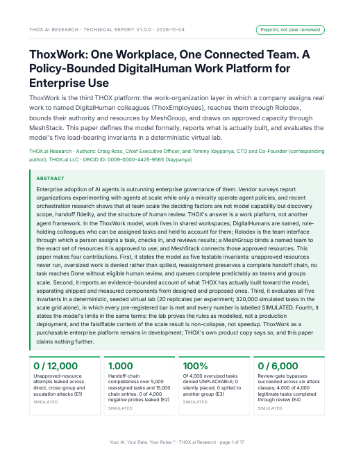

# ThoxWork: One Workplace, One Connected Team — v1.0.1 (public edition)

[](LICENSE)
[](https://thox.ai/research)
[](https://doi.org/10.5281/zenodo.23963936)

**THOX.ai Research technical report, v1.0.1 (public edition), published 2026-11-04.**
Authors: Craig Ross, Chief Executive Officer, THOX.ai, and Tommy Xaypanya,
Chief Technology Officer & Co-Founder, THOX.ai (corresponding author).
ORCIDs: Craig Ross [0009-0005-9872-3673](https://orcid.org/0009-0005-9872-3673);
Tommy Xaypanya [0009-0000-4425-9565](https://orcid.org/0009-0000-4425-9565).
Preprint, not peer reviewed. License: CC BY 4.0 (paper and evidence);
experiment code Apache-2.0 (see `NOTICE.md`).

This folder is the publication record for the paper inside
`ttracx/thox-research-paper`. The sibling folder `../v1.0.0/` carries a
separate expanded enterprise edition prepared for internal review; this
v1.0.1 folder carries the canonical THOX.ai Research paper and its
evidence.



## About the paper

Enterprise adoption of AI agents is outrunning enterprise governance of
them. THOX's answer is a work platform, not another agent framework. In
the ThoxWork model, work lives in shared workspaces; DigitalHumans are
named, role-holding colleagues (ThoxEmployees) who can be assigned tasks
and held to account for them; Rolodex is the team interface through which
a person assigns a task, checks in, and reviews results; a MeshGroup
binds a named team to the exact set of resources it is approved to use;
and MeshStack connects those approved resources.

The paper states the model as five testable invariants, reports an
evidence-bounded account of what THOX has actually built toward the
model (shipped and measured components separated from designed and
proposed ones), and evaluates all five invariants in a deterministic,
seeded virtual lab. Every pre-registered bar is met and every evaluation
number is labelled SIMULATED: the lab proves the rules as modelled, not
a production deployment. ThoxWork as a purchasable enterprise platform
remains in development; THOX's own product copy says so, and this paper
claims nothing further.

## DOI and canonical copies

- **DOI: [10.5281/zenodo.23963936](https://doi.org/10.5281/zenodo.23963936)** (concept DOI, all versions: [10.5281/zenodo.23963935](https://doi.org/10.5281/zenodo.23963935))
- Zenodo record: https://zenodo.org/records/23963936 — the version of record (paper PDF; the HTML edition is carried on the surfaces below)
- Paper page: https://thox.ai/research/papers/thoxwork
- Interactive demo (hosted on thox.ai; Zenodo serves HTML as text, so the demo does not live on the record): linked from the paper page, and in this folder at `paper/ThoxWork_Demo_v1.1.0.html`
- Hugging Face: folder `thoxwork/` in the [Thox-ai/thox-whitepapers](https://huggingface.co/datasets/Thox-ai/thox-whitepapers) dataset (paper PDF + HTML edition)
- This folder: paper PDF + HTML edition + demo in `paper/`, evidence in `artifact/exp/`

| File | SHA-256 |
|---|---|
| `paper/THOX_ThoxWork_Research_Paper_v1.0.1.pdf` (190,880 bytes) | `428b813729882fc1d77319f3c76f518e29465d77dc32c3482ae5a197832aeeba` |
| `paper/THOX_ThoxWork_Research_Paper_v1.0.1.html` (1,612,647 bytes) | `e59465ff8fe61b6df7b026659b19c2a83c9065e5142ed49c8d49aa31bf7ebdb7` |
| `paper/ThoxWork_Demo_v1.1.0.html` (22,317 bytes) | `969daacca2ae6d90bff7ce62be5464ea826a3a77f8bc1723209ae5e36ce90b0d` |
| `artifact/exp/results/summary.json` (32,089 bytes) | `f7c72f64b9b8c6f2e1663fbb014374858b2251f2aeaa7d989393a6cdb071dd79` |

`MANIFEST.sha256` in this folder lists the SHA-256 of every file in the
folder.

## Headline results (all SIMULATED)

From `artifact/exp/results/summary.json`, the single evidence source;
20 replicates per experiment, master seed 20261104:

- **E1, policy enforcement:** 0 of 12,000 violating attempts leaked an
  unapproved resource; 0 of 8,000 legitimate attempts were falsely
  blocked; audit coverage 1.0.
- **E2, handoff integrity:** 5,000 of 5,000 reassigned tasks kept a
  complete handoff chain (15,000 entries); 0 of 4,000 negative probes
  leaked chain data across groups.
- **E3, admission control:** 4,000 of 4,000 oversized tasks denied
  UNPLACEABLE, 0 silently placed, 0 spilled across groups; at exactly
  1.00x pooled capacity work is admitted, at 1.01x it is denied.
- **E4, review gate:** 0 of 6,000 bypass attempts in six classes
  succeeded; 4,000 of 4,000 legitimate completions passed through
  eligible human review. With the gate switched off in the control arm,
  4,000 of 4,000 completed without review, which is what proves the
  checker discriminates.
- **E5, scale:** all 16 cells (team sizes 2/4/8/16 x group counts
  1/2/4/8; 320,000 simulated tasks) reached completion 1.0. The paper's
  falsifiable claim is non-collapse, not speedup; apparent efficiency
  above 1.0 is identified in the paper as a model artifact, and the
  reviewer bottleneck at team size 16 is reported as the real signal.

## Quick start

```bash
git clone https://github.com/ttracx/thox-research-paper.git
cd thox-research-paper/papers/thoxwork/v1.0.1
# Read the paper:
open paper/THOX_ThoxWork_Research_Paper_v1.0.1.pdf        # macOS
xdg-open paper/THOX_ThoxWork_Research_Paper_v1.0.1.pdf    # Linux
# Run the interactive demo (single file, no network needed):
open paper/ThoxWork_Demo_v1.1.0.html
# Reproduce the evidence (Python 3, standard library only):
python3 artifact/exp/thoxwork_experiments.py
# Compare against the shipped evidence source:
# artifact/exp/results/summary.json, SHA-256 in the table above.
```

## Folder layout

| Path | Contents |
|---|---|
| `paper/` | The shipped edition: paper PDF, single-file HTML edition, interactive demo (canonical bytes, hashes above). |
| `artifact/exp/` | The evidence suite: `thoxwork_experiments.py` (deterministic oracle, Python standard library only) and `results/summary.json`, the single evidence source for every printed number. |
| `artifact/wp/qa/VERIFIER-REPORT.md` | The independent verifier's report: the suite re-run by a non-producer, byte-identical summary, all pre-registered bars re-judged from the numbers alone. |
| `docs/` | `USER_GUIDE.md`, `QUICKSTART.md`, `DEVELOPMENT.md`, `previews/` (rendered cover). |
| `HANDOFF.md` | Publication record and agent handoff: status, surfaces, consent record, open items. |
| `CITATION.cff`, `CITATION.bib` | Citation set. |
| `LICENSE`, `LICENSE-CODE.txt`, `NOTICE.md` | CC BY 4.0 for the paper and evidence, Apache-2.0 for the experiment code, and IP attribution. |
| `MANIFEST.sha256` | SHA-256 of every file in this folder. |

The ThoxWork platform source code is not in this repository. This folder
is the paper and its evidence record; the products the paper describes
(ThoxWork, Rolodex, ThoxEmployee) live in their own repositories under
their own terms.

## Documentation map

- User guide: [docs/USER_GUIDE.md](docs/USER_GUIDE.md)
- Quick start: [docs/QUICKSTART.md](docs/QUICKSTART.md)
- Development: [docs/DEVELOPMENT.md](docs/DEVELOPMENT.md)
- Publication record: [HANDOFF.md](HANDOFF.md)

Your AI. Your Data. Your Rules.™
