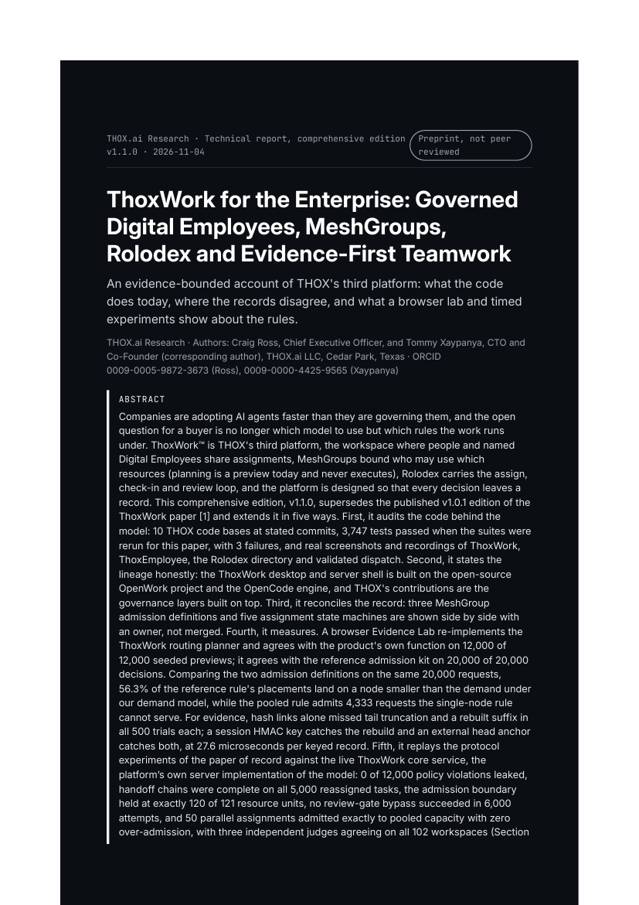

# ThoxWork for the Enterprise: Governed Digital Employees, MeshGroups, Rolodex and Evidence-First Teamwork

**THOX.ai Research technical report, comprehensive edition v1.1.0, 2026-11-04.**
Authors: Craig Ross, Chief Executive Officer, THOX.ai, and Tommy Xaypanya,
Chief Technology Officer & Co-Founder, THOX.ai (corresponding author).
ORCIDs: Craig Ross [0009-0005-9872-3673](https://orcid.org/0009-0005-9872-3673);
Tommy Xaypanya [0009-0000-4425-9565](https://orcid.org/0009-0000-4425-9565).
Preprint, not peer reviewed. License: CC BY 4.0 (paper and evidence);
experiment code Apache-2.0 (see `NOTICE.md`).

This edition supersedes v1.0.1 (DOI 10.5281/zenodo.23963936) under the
same concept DOI, 10.5281/zenodo.23963935. It merges the comprehensive
product-measured account of the platform with the live core-service
acceptance replay, reconciles the three admission definitions in the
record (the pooled-capacity rule governs; ruling recorded in Sections
7.7 and 11), and corrects the RolodexGo product-status framing (the
Teams and Work changeset is built and test-covered but has not landed;
the shipped client is the contacts client with Sadie Link).

## Headline results

From `artifact/exp/results/summary.json`, the single evidence source for
every number in the paper:

- **Product tests (MEASURED):** 3,747 tests passed when the suites were
  rerun across 10 repositories, with 3 failures and 34 skipped.
- **Planner agreement (MEASURED):** the Evidence Lab planner and the
  product planner agree on 12,000 of 12,000 routing decisions and 55,832
  of 55,832 per-node verdicts; the lab reproduces the reference admission
  kit on 20,000 of 20,000 decisions.
- **Admission divergence (MEASURED):** 56.3 percent (2,572 of 4,570) of
  reference-rule placements land on a node too small for the request; the
  pooled rule admits 4,333 requests the reference rule cannot place.
- **Live core replay (MEASURED, Section 7.7):** the protocol experiments
  of the paper of record replayed against the live ThoxWork core
  service: 0 of 12,000 cross-tenant violations leaked, record
  completeness 1.0 over 5,000 tasks, admission boundary at 120 of 121
  resource units, 0 of 6,000 review-gate bypass attempts succeeded (with
  a discriminating control arm), 50 parallel assignments admitted to
  exactly the pooled capacity, three independent judges in agreement on
  all 102 workspaces.
- **Protocol oracle (SIMULATED):** the E1-E5 deterministic experiments of
  the paper of record are unchanged and remain labelled simulated; the
  E5 scale claim is non-collapse, not efficiency.

## DOI and canonical copies

- **Version DOI: [10.5281/zenodo.23965052](https://doi.org/10.5281/zenodo.23965052)** (concept DOI, all versions: 10.5281/zenodo.23963935)
- Zenodo record: https://zenodo.org/records/23965052 (PDF + HTML)
- Paper page: https://thox.ai/research/papers/thoxwork
- Interactive demo: in this repository at `paper/ThoxWork_Demo_v1.1.0.html`, and linked from the paper page
- Hugging Face: folder `thoxwork/` in the [Thox-ai/thox-whitepapers](https://huggingface.co/datasets/Thox-ai/thox-whitepapers) dataset
- This repository: paper PDF + HTML edition + demo in `paper/`, evidence in `artifact/exp/`

| File | SHA-256 |
|---|---|
| `paper/THOX_ThoxWork_Research_Paper_v1.1.0.pdf` (434,438 bytes) | `8d7ad1c796a4184f84c1595d4a5ddc85d66b42d4bd26ce5e472eb083c1042819` |
| `paper/THOX_ThoxWork_Research_Paper_v1.1.0.html` (2,259,668 bytes) | `7b39596a4dc28ae24545c53e53c79d8e7026bfb26df454c684d90f3168a9dd83` |
| `paper/ThoxWork_Demo_v1.1.0.html` (9,222 bytes) | `df020dc44c22bf0d07adcabcb61d436b6c1ba562e009bdc5a841649535e0997b` |

## Repository layout

| Path | Contents |
|---|---|
| `paper/` | The shipped edition: paper PDF, single-file HTML edition, interactive demo (canonical bytes, hashes above). |
| `artifact/exp/` | The merged evidence: `results/summary.json` (single evidence source), the product-test, planner, admission-divergence, Evidence Lab and live-acceptance records it merges, and the paper of record's deterministic oracle code with its own results. |
| `artifact/wp/` | The build: `paper.src.html`, `build.py`, `surgery.py` (the merge record), `qa/` (QA report, contact sheets, numbers proof). |
| `docs/` | `USER_GUIDE.md`, `QUICKSTART.md`, `DEVELOPMENT.md`, `previews/` (rendered cover). |
| `.agents/HANDOFF.md` | Agent handoff for this folder. |
| `CITATION.cff`, `CITATION.bib` | Citation set for this edition. |
| `LICENSE`, `LICENSE-CODE.txt`, `NOTICE.md` | CC BY 4.0 for the paper and evidence, Apache-2.0 for the experiment code, and IP attribution. |

The ThoxWork platform source code is not in this repository. This repo
is the paper and its evidence record; the products the paper describes
(ThoxWork, Rolodex, ThoxEmployee) live in their own repositories under
their own terms.

Your AI. Your Data. Your Rules.™
